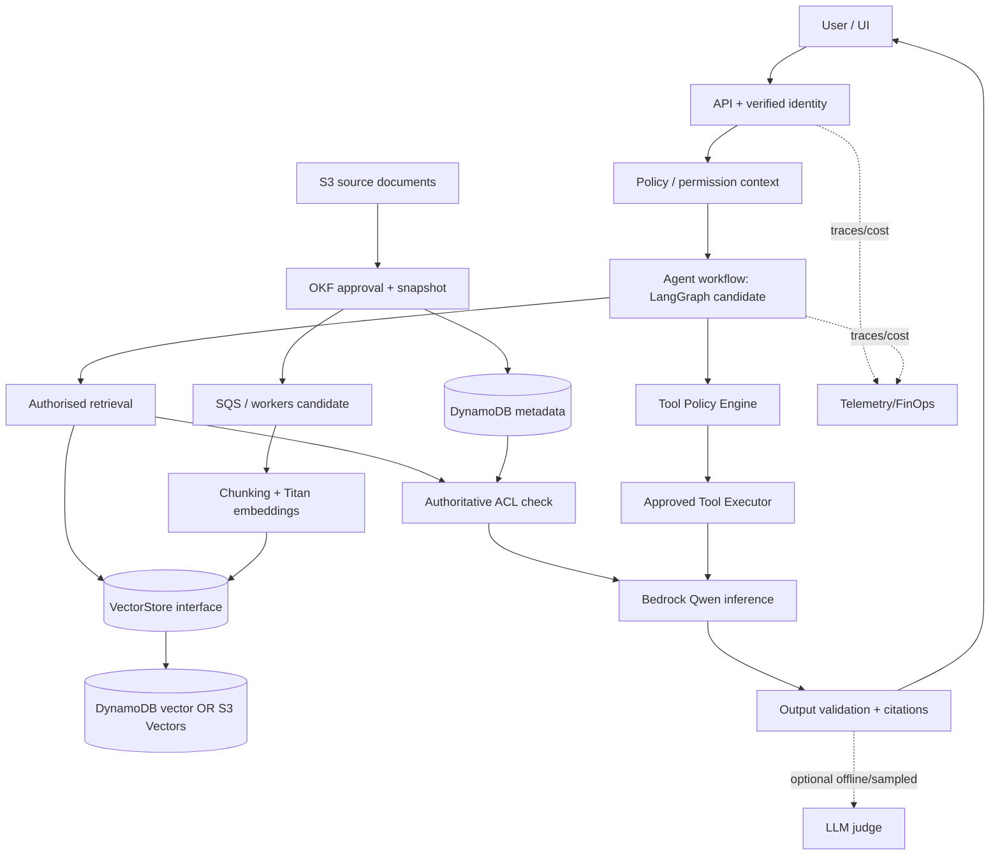

# SYSTEM ARCHITECTURE — Conceptual v0.1

**Status:** Design hypothesis pending codebase review and ADR acceptance. This is not an as-built system.

## Trust boundaries
1. Browser -> authenticated API; claims verified server side.
2. Untrusted prompt and retrieved documents -> deterministic policy; neither can elevate permissions.
3. Application -> AWS: least-privilege workload AWS credentials, audited calls, bounded budget.
4. Model tool proposal -> policy engine -> schema and resource checks -> approval -> executor. Model cannot call service directly.
5. Retrieved chunks -> authoritative ACL, current approval/revocation, filtering before sending to model.
6. Model output -> citation/format/policy checks before user response; judges are not security authorities.

## Proposed deployment
One Linux EC2 running K3s with isolated namespaces; Argo CD syncs Helm/manifests via GitOps. GitHub Actions runs PR checks, produces versioned images, signs/scans where practical and updates deployment manifests via reviewed PR; Argo CD deploys. Secure access to control plane, Argo CD and dashboards through constrained network access/SSM; avoid publishing admin UIs. AWS managed Bedrock, DynamoDB, S3 and optional S3 Vectors remain outside K3s. One EC2 instance is a single point of failure; HA needs a different design.

## Operational invariants
- Every request carries correlation/trace ID, principal, tenant, purpose and effective policy version.
- Never log raw secrets, patient-like synthetic records or prompts with confidential content by default.
- Idempotency for ingestion and mutating tools; bounded retries and explicit DLQ; avoid blind replay of side effects.
- Model id/version, prompt id/version, index version, evaluation dataset version, cost and tool execution decisions are traceable.
- Enforce quotas: max tool steps, model invocations, tokens, timeouts, retries, concurrency and budget.

## Future ADRs
Runtime K3s vs EKS; framework strategy; authentication/tenancy; workload IAM; indexing/versioning/revocation; tool execution policy; judge methodology; environment and cost strategy.
